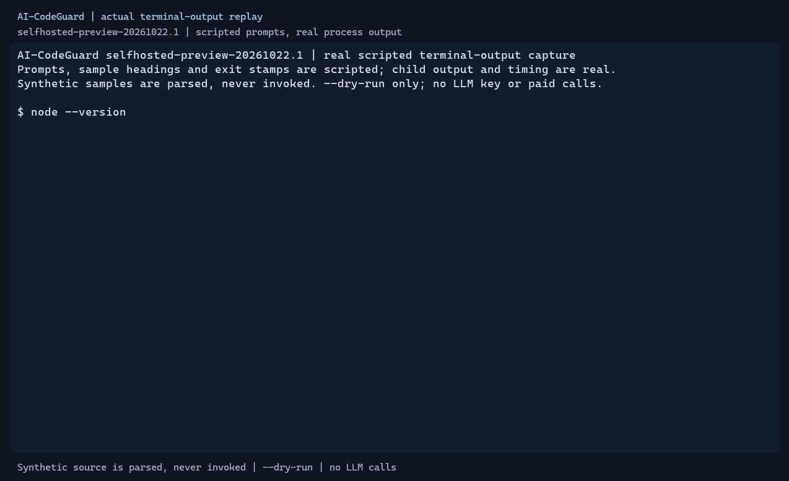

# 真实演示：安装 → eval 告警 → 修复 → 复扫

**2026-10-27 更新：** 当前下载入口为已公开的 [selfhosted-preview-20261026.1](https://github.com/longyuanai/AI-CodeGuard/releases/tag/selfhosted-preview-20261026.1)，源码 `d5d474cf5d4d27fd103171276afc5967949708ed`，实际安装 Zod 4.6.6/OpenAI 6.0.0，发布前源码锁与全新消费者审计为 0。请按[当前快速上手](../QUICKSTART.md)使用新版同批附件和校验。下方回放、旧哈希和 `3 high` 是历史 `20261022.1` 输出，不是新包录制证据；真实 App、付费 provider 和其他 Node 补丁仍未验证。

> 历史记录：2026-10-25，20261022.1；发布于项目 GitHub。真实校验、安装和扫描输出回放，匿名下载证据另见日志；没有向个人发送邀请或发布到其它平台。

准备提交一个接收 JSON 字符串的接口时，如果有人把 `JSON.parse(input)` 改成了 `eval(input)`，
代码仍可能在正常输入下运行，却引入把输入当作 JavaScript 执行的风险。AI-CodeGuard 的自部署预览版
提供了一个本机检查入口：先用 Tree-sitter 和静态规则找可疑模式，再由开发者判断和修复。

这次先邀请开发者体验最容易验证的一段：**本地 CLI、合成代码、`--dry-run`，无需 LLM key**。
不是在线托管服务，也不是完整安全审计。



动图渲染自真实子进程输出，保留实际时间，末尾增加 2.5 秒停留便于阅读；提示、标题和退出码标注由录制脚本添加。
它是终端输出回放，不是桌面录屏，也不是模拟扫描结果。

## 2026-10-25 从 20261022.1 安装的历史记录

固定版本：[selfhosted-preview-20261022.1](https://github.com/longyuanai/AI-CodeGuard/releases/tag/selfhosted-preview-20261022.1)，
源码 `9b949df555ea1e215accf7659359bba358ebbeb1`，CLI 组件仍为 `0.4.0`，要求 Node `^24.22.0`。
本次逐字执行快速上手时，在独立临时目录匿名下载该批 tgz 与 SHA256SUMS，核对安装包 SHA256：
`d8fadbef81e01f257956f3cea5251e70feea9040570fb8e0b2ce830331cc7a82`，实际安装和扫描通过。
最终录制时 CDN 连接重置，回放复用本日已匿名下载的相同文件并重新校验，再记录真实 npm 安装、版本/帮助和修复复扫；
该 cast 没有记录一次新下载。默认录制脚本可匿名下载，也可用可选的 `previously-downloaded-assets-directory` 参数明确复用已有文件。
先校验、后安装，不能混用其它批次的校验文件：

```sh
npm init -y
npm install ./ai-codeguard-0.4.0.tgz --ignore-scripts --omit=dev --engine-strict --registry=https://registry.npmjs.org
npx --no-install ai-codeguard --version
```

本节保留旧批次安装记录；当前匿名下载、校验和完整 PowerShell 配方见[快速上手](../QUICKSTART.md)，其默认链接已切换为修复批次；
[本次原始记录](../dev/validation/PREVIEW-2026-10-25-demo.log) 和 [录制脚本](../examples/record-preview-demo.mjs) 可复核。

## 实际演示：危险代码 → 告警 → 修复 → 复扫

样本只定义函数，不调用它。危险版的第三行：

```typescript
// Synthetic scan-only fixture. Do not invoke this function during rehearsal.
export function parsePayload(input: string): unknown {
  return eval(input);
}
```

在已安装 CLI 的临时项目中运行：

```sh
node node_modules/ai-codeguard/dist/index.js scan probe.ts --dry-run --output text --fail-on high
```

2026-10-25，Windows / Node 24.22.0 / npm 11.19.1，固定公开附件实际输出片段：

```text
✗ CRITICAL  CG-003 CWE-95  Code Injection (eval)
  probe.ts:3-3
Summary: 1 findings (1 critical)
[exit=1]
```

输出第 3 行对应上述完整样本。
`[exit=1]` 由演示记录器标注真实子进程退出码，不是 CLI 自己打印的文字。
对于这个约定接收 JSON 的例子，移除 eval，改成 JSON.parse，再扫描同一个文件：

```text
✓ No vulnerabilities found.
Summary: No findings
Files scanned: 1
[exit=0]
```

三个版本的实际结果是：安全 **0 发现 / 退出 0**，危险 **1 发现 / 退出 1**，修复 **0 发现 / 退出 0**。
均扫描 1 个文件，零跳过、零 LLM 调用和零模型费用。修复后无告警只代表这次静态检查结果；
生产代码仍需数据结构校验、权限设计和人工审查。
完整复制步骤、原始输出和[新版完整终端回放](../examples/preview-install-demo.cast)见[快速上手](../QUICKSTART.md)。

## 下载和安装入口

- [固定公开预发布 selfhosted-preview-20261026.1](https://github.com/longyuanai/AI-CodeGuard/releases/tag/selfhosted-preview-20261026.1)
- [CLI 安装包](https://github.com/longyuanai/AI-CodeGuard/releases/download/selfhosted-preview-20261026.1/ai-codeguard-0.4.0.tgz) / [SHA256SUMS](https://github.com/longyuanai/AI-CodeGuard/releases/download/selfhosted-preview-20261026.1/SHA256SUMS)
- [完整快速上手与故障定位](../QUICKSTART.md)

需要 **Node `^24.22.0`（>=24.22.0、<25）**，实际演示使用 24.22.0。
先按快速上手核对 SHA256，再从本地 tgz 安装：

```sh
npm install ./ai-codeguard-0.4.0.tgz --ignore-scripts --omit=dev --engine-strict --registry=https://registry.npmjs.org
```

不要把 `npm install ai-codeguard@0.4.0` 当作这个固定预发布附件；包内版本虽然同为 0.4.0，来源不同。
安装时需要联网获取运行依赖，扫描演示本身不调用模型或执行样本。

## 当前边界

- **2026-10-27 发行范围：** 修复已进入上述新预览附件；旧 20261022.1 的 CLI 与源码 ZIP 没有被覆盖。2026-10-26 旧包的 3/2 high 记录属于同一 Zod 依赖公告的传播，尚未证明真实远程可利用。新包也不是通用资源耗尽沙箱，配置/自定义规则仍须可信。
- **2026-10-26 历史更新（公开新预览前）：** [PR #21](https://github.com/longyuanai/AI-CodeGuard/pull/21) 已合并，main 的 Zod 4.6.6/OpenAI 6.0.0 和集合上限已验证，源码/新打包消费者审计 0；当时公开的 `20261022.1` 包和真实回放没有改变，旧包全新安装仍 3 high，源码 ZIP 仍 2 high。当时新预览仍是草稿，不能将 main 的修复状态套到旧附件。
- **2026-10-25 历史 20261022.1 风险：** 当日公开 CLI 隔离生产安装审计报告 **3 个 high 包条目**（ai-codeguard/openai/zod 对同一 [GHSA-mrhx-c7xc-m3w5](https://github.com/advisories/GHSA-mrhx-c7xc-m3w5) 的聚合）。Zod `<4.6.6` 校验过大的受限集合时可能耗尽内存，公告修补版本为 `4.6.6`；动图保留了真实 `3 high` 安装提示。当日小型合成 `--dry-run` 不是该漏洞的利用验证或无风险证明，未升级依赖、未绕过 CI，历史审计 0 不是当前结论。
  当日实装 Zod `3.25.76` / OpenAI `4.104.0`，`--dry-run` 仍会校验配置；所需兼容迁移后来由 PR #21 完成，旧附件未更新。公告补丁针对有边界集合，并非彻底消除所有资源耗尽问题。
- 支持 JS/TS、Python、Go、Java、PHP；不同语言的规则覆盖不同，见[项目规则表](../../README.md#supported-languages)。
- 项目标注语料的 Stage 1 历史指标是 precision **95.8%**、recall **92.0%**，不是所有真实项目的准确率保证，
  也不是本次三个演示样本得出的统计结论。
- 真实 GitHub App 注册/安装、签名投递到真实 PR、评论和 Check Run 联调**尚未完成**。
  App 是需要自己的部署环境、HTTPS 地址及仓库安装的独立入口；没有在线托管服务。
- 付费 provider、其它 Node 24 补丁和本轮未实际运行的平台仍未验证。CLI 的可选 LLM 能力不包含在这次静态体验中。
- 无告警不代表无漏洞。`--dry-run` 是静态候选筛选，仍可能误报、漏报，不能代替人工审计。
- 历史预览版 `selfhosted-preview-20261021.1` 源码 ZIP 的 Vitest/mocker 4.1.11 开发链在 2026-10-22 核对时有两项 moderate，已由 [PR #19](https://github.com/longyuanai/AI-CodeGuard/pull/19) 在 main 修补为 4.1.12。
  本页新版源码包已包含修复；CLI 安装包不包含这条测试链。不要把旧源码包的历史审计 0 当作当前结果。

## 邀请开发者试用

想请首批 **3～5 位开发者**花几分钟跑通上述合成示例，再尝试自己有权检查的代码。
最希望知道：能否顺利安装、退出码是否清楚、报告是否容易理解，以及遇到哪些误报或漏报。
请通过[试用反馈 Issue](https://github.com/longyuanai/AI-CodeGuard/issues/new?title=%5BPreview%20feedback%5D&body=Release%3A%20selfhosted-preview-20261026.1%0AOS%20%2F%20Node%20%2F%20npm%3A%0AInstall%20success%3A%0AScan%20completed%20%2F%20exit%20code%3A%0AFalse%20positive%20or%20missed%20finding%20%28synthetic%20repro%20only%29%3A%0AImprovements%3A%0A%0ARedact%20keys%2C%20tokens%2C%20private%20source%20and%20customer%20data.)记录环境、结果和改进建议。
只提供脱敏命令或最小合成复现，**不要上传密钥、Token、私钥、私有源码或客户数据**。
提交 Issue 需要 GitHub 登录，没有收集用户信息的额外表单或后台。

可单独使用的邀请文案（草稿，未发送）：

> 我在做 AI-CodeGuard 的自部署预览版，想邀请 3～5 位开发者试用本地静态 CLI。
> 用 Node ^24.22.0 跑一遍“eval 告警→修复→复扫”，不需要 LLM key。
> 新版下载：https://github.com/longyuanai/AI-CodeGuard/releases/tag/selfhosted-preview-20261026.1 。
> 上手：https://github.com/longyuanai/AI-CodeGuard/blob/main/docs/QUICKSTART.md 。
> 如果安装卡住、报告看不懂，或发现误报/漏报，欢迎提交脱敏反馈；不要上传私有源码或凭据。
> 这是预览工具，真实 GitHub App 联调还未完成，也不替代人工安全审计。
